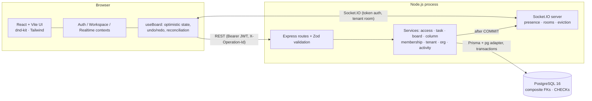

# Architecture

## 1. System overview

* **Single primary backend** (Node/Express). The optional Python AI service from the preparation guide is intentionally *not* built (not in the official PDF; the brief asks to prioritise the mandatory scope).
* **REST for writes, Socket.IO for notifications.** Every write is authorized and validated in exactly one place (services). The socket never accepts mutations.

## 2. Backend module map (`backend/src`)

| Layer | Files | Responsibility |
|---|---|---|
| `config/` | `env.js`, `db.js` | typed env (secrets required in production), Prisma client with `pg` driver adapter |
| `routes/` | `index.js` | thin controllers: parse+validate (Zod) → call a service → shape the response; idempotency wrapper (`utils/route.js`) |
| `middleware/` | `auth.middleware.js`, `error.middleware.js` | bearer-token → live user (checks `token_version`), uniform JSON errors |
| `services/` | `access`, `task`, `board`, `column`, `tenant`, `org`, `membership`, `activity`, `auth`, `realtime`, `locks` | all business rules, transactions, authorization, event emission |
| `sockets/` | `index.js`, `presence.js` | handshake auth, `tenant:join` authorization, ref-counted presence, eviction on revocation |
| `utils/` | `schemas`, `validate`, `errors`, `tokens`, `route` | Zod schemas, error types, JWT helpers |

(There is no separate `controllers/` directory: with ~40 small handlers, route files *are* the controllers and keep the request → service mapping visible in one screen.)

## 3. Life of a task move (the central flow)

1. User drops a card. `KanbanBoard` computes the destination column and index; `useBoard.moveTask` applies `moveLocal` **optimistically**.
2. `PATCH /api/tasks/:id/move { expectedVersion, columnId, position }` with `X-Operation-Id`.
3. `task.service.move`: load task → authorize against **its** tenant → open transaction:
   * `SELECT … FOR UPDATE` on every column row of the board (id order ⇒ deadlock-free) — serialises ordering changes *per board*;
   * re-read the task **inside** the lock and compare `version` (stale ⇒ **409** with the authoritative task);
   * verify destination column ∈ same board (and tenant);
   * rewrite positions of the destination (and compact the source) so each column stays `0..n-1`;
   * bump the moved task's `version`, write the `activity_logs` row.
4. After `COMMIT`, emit `task:moved` (+ `activity:created`) to room `tenant:<id>` with `positions[]`.
5. Originating client applies the HTTP response; other clients apply the event. Events carry versions, so late/duplicate events are ignored.
6. On any failure the client rolls back to its snapshot and re-fetches the board.

## 4. Task ordering

Positions are **dense integers per column** (`0..n-1`). Reasons: simplest invariant to test and to render, and boards are small (tens–hundreds of cards).
Cost: a move rewrites up to *n* rows of one or two columns. For very large columns a fractional/rank-based key (e.g. LexoRank) would reduce writes — listed under future improvements.
Concurrency safety comes from the per-board row lock, not from a unique constraint, so there are no transient duplicate-key failures.
Verified by tests: 8 concurrent moves across 4 columns and 6 concurrent creates leave every column exactly `0..n-1`.

## 5. Concurrency control

| Operation | Mechanism |
|---|---|
| Task edit | `UPDATE … WHERE id=? AND tenant_id=? AND version=expected` (atomic compare-and-set) → 0 rows ⇒ re-read ⇒ 404 if deleted, else **409** + `current` |
| Task move | version compared under the board lock (above) |
| Task delete | optional `expectedVersion`; deleting an already-deleted task → 404 |
| Reorder of *different* tasks | serialised by the board lock; both succeed; positions converge (server-authoritative) |
| Retries | `X-Operation-Id` idempotency cache (2 min, in-memory) |
| Client policy | adopt `details.current`, refetch the board, toast; the task panel offers **"Discard mine, load latest" / "Keep mine & overwrite"** (the latter resubmits against the new version — a deliberate, user-confirmed overwrite) |

## 6. Undo / redo

Client-side history of **own** operations (`move`, `edit`; max 50). Each entry stores `undo`/`redo` payloads and the **version the operation produced**.
Undo/redo are ordinary versioned requests (`expectedVersion = entry.version`), so they can never silently overwrite someone else's later change:
if the task changed, the server answers 409, the entry is dropped, the UI says *"Can't undo … someone changed this task since"* and the board is reconciled.
Entries for the same task are re-chained to the new version only when `entry.version === version-before-this-op` (nothing foreign slipped in).
Not undoable: create/delete (deleting is irreversible by design; create-undo would need delete semantics) — documented limitation.

## 7. Frontend structure (`frontend/src`)

`context/` (Auth, Workspace, Realtime, Toast) → `hooks/` (`useBoard`, `useMembers`) → `components/` (Kanban, TaskPanel, ActivityPanel, ui) → `pages/` → `layouts/AppShell`.
* `WorkspaceContext` loads orgs/tenants from the API, persists only a *preference*, and **clears tenant state immediately** on switch.
* `RealtimeContext` owns the socket lifecycle: join on connect, status (`connecting/connected/reconnecting/denied`), presence, resync callbacks after re-join.
* `utils/board.js` holds the pure board-state functions (unit-tested).

## 8. Scalability notes (honest)

Works for a single Node process. To scale out: Redis adapter for Socket.IO, Redis for presence + idempotency cache, sticky sessions or Redis-backed rooms.
The per-board lock scales with the number of *boards* (contention only inside one board). Activity feed is index-backed (`tenant_id, created_at DESC`) with keyset pagination.
No load testing has been performed; no throughput claims are made.
